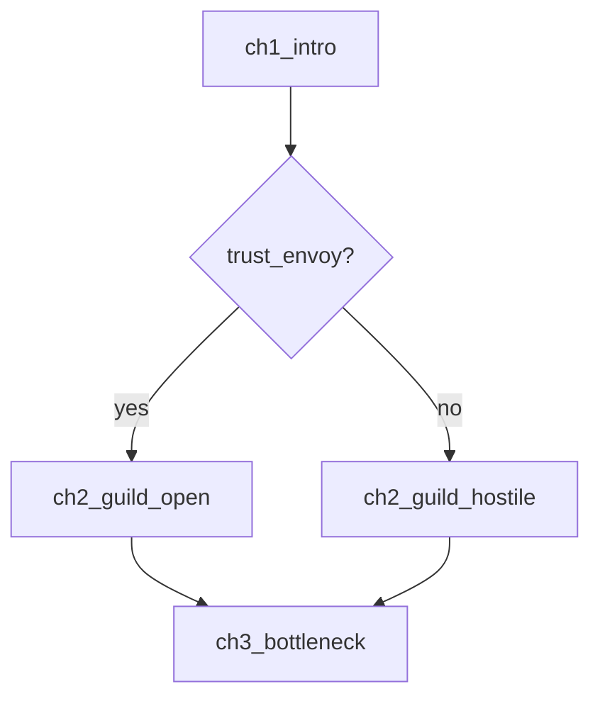

# Game Story Structure

## Levels

**Saga / game**: the central question and the transformation across the whole game.
**Act or route**: a movement with its own question, rising tension, and resolution that also moves the game-level question. An act that resolves without changing the larger story is filler.
**Chapter / encounter set**: a play session's worth. Something changes by the end, and the player wants the next one.
**Scene**: one place, one situation, something changes. A scene that changes nothing gets cut or merged.
**Beat**: one turn inside a scene. Mark the emotional register.

## What makes it work

- **Causation over sequence.** "Therefore" and "but," not "and then." Reorder the scenes: if nothing breaks, you have a sequence, not a plot.
- **Escalating stakes**, emotional, moral, or informational, not only bigger threats.
- **Setup and payoff.** Track open setups explicitly. Every payoff needs a setup; every setup needs a payoff or a deliberate cut.
- **Tension and release** at every scale. Sustained tension becomes numbness.

## Game-specific

- **Spine plus branches.** Define the spine (what every player sees) first. Branches are additions or variations of the spine, not parallel stories, unless the designer chooses a fully split route structure.
- **Branch cost.** For each divergence, estimate scenes to write, flags to track, and test paths added. Prefer bottlenecks (diverge, then reconverge) and reactive text variants over new scenes.
- **State the player can feel.** A flag nobody ever sees or feels is dead weight. For each flag, name where the player notices it.
- **Respect the loop.** Run-based games: structure the story across runs (meta-progression of revelation), and make single-run events self-contained. Visual novels: structure by route and chapter with a common route. Tactical RPGs: place story between battles and let battles carry story beats through objectives and units.
- **Pacing against play.** Story beats compete with gameplay time. Mark where the player is idle versus engaged, and avoid stacking long scenes back to back.
- **Replay value.** Mark what a second playthrough reveals that the first hid.

## Scene entry template

```
### scene_id: Title
Purpose: why this scene exists for the whole story
Characters: ...
State in: character / relationship / world state, flags read
State out: what changed, flags set
Reveals: information the player gains
Register: emotional trajectory
Beats:
  1. ...
  2. ...
Setup/payoff: sets up ... / pays off ...
Design requests: mechanics this needs that may not exist
```

## Flag ledger

| Flag | Type / default | Set in | Read in | Player notices it where |
|---|---|---|---|---|

Defects: set never read, read never set, two scenes disagreeing about meaning, a flag with no visible effect.

## Branch map (Mermaid)



Label diamonds with the flag or choice that decides them. Keep one diagram per act; split when it stops fitting on a screen.

## Common problems

- **Saggy middle**: no escalation between the first turn and the crisis. Add a reversal or raise the personal cost.
- **Rushed ending**: the payoffs are crammed into the last chapter. Spread payoffs across the final act.
- **Filler arc**: resolves its own conflict, changes nothing larger.
- **Disconnected scenes**: no causal link to neighbors.
- **Stakes plateau**: each act is the same size of threat.
- **Branch sprawl**: more scenes than can be written and tested. Convert to variants or cut.
